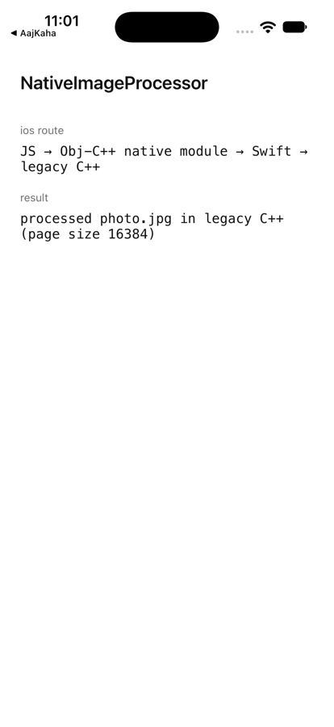

# One TurboModule spec, two native backends

Example code for the article [How a Creative Solution Kept Our Legacy C++ Image Processing Alive](https://turjoysaha.com/writing/how-a-creative-solution-kept-legacy-cpp-image-processing-alive).

A React Native 0.87 app (New Architecture) where JavaScript calls one TurboModule, `NativeImageProcessor`, and each platform backs it differently:

- **Android**: a pure C++ TurboModule. JavaScript calls straight into C++ over JSI, with no Java in between. The C++ is built 16 KB-aligned.
- **iOS**: an Objective-C++ native module that forwards to an existing Swift class, which calls the same C++.

Both end up in the same unchanged legacy C++ code.

| Android (16 KB page emulator) | iOS |
| --- | --- |
|  |  |

```text
                 JavaScript
      NativeImageProcessor.process(path)
                     │
       one spec + codegen (AppSpecs)
          ┌──────────┴──────────┐
       Android                 iOS
   C++ TurboModule      Obj-C++ module → Swift
          └──────────┬──────────┘
          legacy C++ image processing
```

## Where things are

| Article step | File |
| --- | --- |
| The spec | [`specs/NativeImageProcessor.ts`](specs/NativeImageProcessor.ts) |
| Codegen config | `codegenConfig` in [`package.json`](package.json) |
| Legacy C++ (stand-in) | [`shared/legacy/`](shared/legacy) |
| Android C++ module | [`shared/NativeImageProcessor.h`](shared/NativeImageProcessor.h) |
| Android registration | [`android/app/src/main/jni/OnLoad.cpp`](android/app/src/main/jni/OnLoad.cpp), [`CMakeLists.txt`](android/app/src/main/jni/CMakeLists.txt), `externalNativeBuild` in [`android/app/build.gradle`](android/app/build.gradle) |
| iOS native module | [`ios/LegacyCppTurboModule/NativeImageProcessor.mm`](ios/LegacyCppTurboModule/NativeImageProcessor.mm) |
| Existing Swift → C++ | [`ios/LegacyCppTurboModule/ImageProcessor.swift`](ios/LegacyCppTurboModule/ImageProcessor.swift) via the C shim [`LegacyImageProcessorC.h`](shared/legacy/LegacyImageProcessorC.h) |
| Using it | [`App.tsx`](App.tsx) |

One template change unrelated to the module: iOS 27 requires the UIScene lifecycle, so [`AppDelegate.swift`](ios/LegacyCppTurboModule/AppDelegate.swift) creates React Native's window in a `SceneDelegate`.

The legacy code here is a small stand-in that returns a string. In a real app it's the image processing you don't want to rewrite. The point is the wiring around it.

## Run it

```bash
npm install
npm run android
```

```bash
cd ios && bundle install && bundle exec pod install && cd ..
npm run ios
```

The screen shows which route the call took on that platform and the string the legacy C++ returned.

## 16 KB page sizes

Google Play requires apps targeting Android 15+ to support [16 KB memory pages](https://developer.android.com/guide/practices/page-sizes). This project uses NDK r27, which doesn't align for 16 KB by default, so [`CMakeLists.txt`](android/app/src/main/jni/CMakeLists.txt) passes the linker flags explicitly. (NDK r28+ does it by default.)

To check the built library:

```bash
unzip -o android/app/build/outputs/apk/debug/app-debug.apk 'lib/arm64-v8a/libappmodules.so' -d /tmp/apk
$ANDROID_HOME/ndk/27.1.12297006/toolchains/llvm/prebuilt/darwin-x86_64/bin/llvm-objdump -p /tmp/apk/lib/arm64-v8a/libappmodules.so | grep LOAD
```

Every `LOAD` segment should show `align 2**14`.

## References

- [Native Modules: Introduction](https://reactnative.dev/docs/turbo-native-modules-introduction)
- [Cross-Platform Native Modules (C++)](https://reactnative.dev/docs/the-new-architecture/pure-cxx-modules)
- [What is Codegen?](https://reactnative.dev/docs/the-new-architecture/what-is-codegen)
- [Support 16 KB page sizes](https://developer.android.com/guide/practices/page-sizes)
